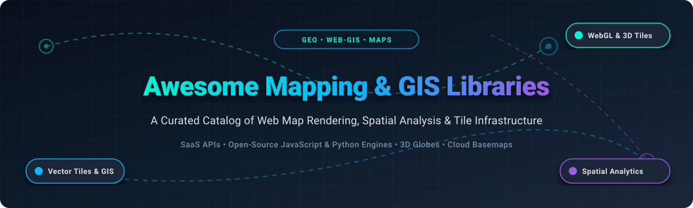

# 🗺️ Awesome Mapping & GIS Libraries 

  

  
  
  
  
  
  

---

## 🧭 Executive Summary & Ecosystem Overview

> A meticulously curated directory of premier **Mapping and GIS (Geographic Information System) Libraries**, **Cloud Basemap Providers**, **Spatial Data Science Engines**, and **Self-Hosted Tile Infrastructure**.

Whether you are architecting a high-throughput geospatial analytics pipeline, designing consumer web maps, embedding 3D digital twins, or transitioning from proprietary mapping services to sovereign open-source tile stacks, this resource tracks the industry leaders, key benchmarks, free-tier limits, and architectural trade-offs.

### 🎯 Key Focus Areas
- 🌐 **Web Map Rendering Engines**: Raster basemaps, WebGL vector tiles, GPU data visualization, and 3D terrain globes.
- 📐 **Geospatial Analytics & Computation**: Spatial indices, topological queries, GeoJSON manipulation, and geometry calculations.
- 🏢 **Cloud & SaaS Platforms**: Turnkey location platforms, routing engines, geocoding APIs, and data warehouse analytics.
- 🛠️ **Open-Source & Self-Hosted Solutions**: Fully sovereign stacks avoiding recurring per-map-load API costs.

---

## 📑 Table of Contents

- [📊 Sector Overview & Market Dynamics](#-sector-overview--market-dynamics)
- [☁️ SaaS & Hosted Platforms](#️-saas--hosted-platforms)
- [💻 Open-Source GitHub Projects](#-open-source-github-projects)
- [🤝 How to Contribute](#-how-to-contribute)
- [💖 Support & Sponsorship](#-support--sponsorship)
- [⭐ Star History](#-star-history)
- [⚠️ Disclaimer](#️-disclaimer)

---

## 📊 Sector Overview & Market Dynamics

The global GIS and web mapping software market is estimated at approximately **$10B–$14B**, with projections accelerating toward **$20B–$30B+** over the next decade at a compound annual growth rate (**CAGR of 8%–15%**).

- **Enterprise Concentration**: The enterprise GIS tier exhibits moderate-to-high concentration dominated by global category leaders like **Google Maps Platform** and **Esri (ArcGIS)**, which control commanding market shares in public sector, urban planning, defense, and high-volume commercial location APIs.
- **Developer Fragmentation**: The web mapping and developer infrastructure tier is **highly fragmented and rapidly evolving**. An explosion of open-source engines (e.g., Leaflet, OpenLayers, MapLibre), cloud-native data warehouses (Snowflake, BigQuery), and specialized developer-first platforms (Mapbox, MapTiler, CARTO) allows engineering teams to construct modular geospatial architectures tailored to specific latency, privacy, and budget requirements.

---

## ☁️ SaaS & Hosted Platforms

A comparison of prominent hosted location APIs, basemap tile servers, and spatial intelligence platforms, sorted descending by company scale and valuation.

| Product | 🏢 Company Scale / Valuation | 📝 Description | 💳 Pricing (Specific Starting Tiers) | 🎁 Free Tier Limit (Permanent / Trial) |
| :--- | :--- | :--- | :--- | :--- |
| **[Google Maps Platform](https://developers.google.com/maps)** | ~$4.0 Trillion Market Cap (Alphabet) | Comprehensive global maps, routes, and places APIs with ubiquitous worldwide data coverage. | Pay-as-you-go from **$7.00 per 1,000 Dynamic Maps requests** (or subscription tiers starting at **$100/month** Starter tier covering up to 50,000 calls). | **$200 recurring monthly credit** (covers up to 28,500 Dynamic Map loads/month free); unlimited no-cost Mobile Native SDK map loads and Embeds. |
| **[Esri ArcGIS](https://www.esri.com/)** | ~$4.0B–$4.5B Valuation (~$1.5B Annual Revenue) | Industry standard enterprise GIS platform with ArcGIS Location Platform and ArcGIS Online services. | Pay-as-you-go starting at **$0.15 per 1,000 tiles** or **$4.00 per 1,000 map sessions**; Creator commercial plans start at **$550/year**. | **Free Developer Account**: 2,000,000 basemap tiles/month, 1,000 basemap sessions/month, 20,000 geocodes/month, and 100 MB feature data storage (free forever, no credit card required). |
| **[HERE Technologies](https://www.here.com/)** | ~$2.5B–$4.0B Valuation (~$1.0B+ Annual Revenue) | Enterprise location platform with mapping, fleet routing, matrix routing, and real-time traffic APIs. | Freemium pay-as-you-go starting at **€1.00 per 1,000 transactions** for volume exceeding the free allowance; custom enterprise contracts available. | **250,000 transactions/month free** forever across map tile, routing, and search APIs (no credit card required to start). |
| **[Mapbox](https://www.mapbox.com/)** | ~$1.3B Valuation (~$100M+ Annual Revenue) | Vector tile map rendering, Mapbox Studio styling, navigation, and location intelligence APIs. | Pay-as-you-go starting at **$5.00 per 1,000 web map loads** beyond the free threshold, with volume discounting down to $3.00/1K loads. | **50,000 web map loads/month free**, 100,000 temporary geocoding requests/month, 100,000 Directions requests/month, and free Mapbox Studio access (free forever). |
| **[TomTom](https://www.tomtom.com/)** | ~$530M Market Cap (~$550M–$600M Annual Revenue) | Automotive and web location APIs powered by TomTom Orbis Maps and open map coalitions. | Pay-as-you-go starting at **$0.50 per 1,000 API requests** beyond free tiers; custom enterprise volume contracts available. | **200,000 vector tiles/month free**, 20,000 raster tiles/month, 10,000 place searches/month, and 2,500 routing transactions/month (free forever, no credit card required). |
| **[CARTO](https://carto.com/)** | ~$300M Valuation (~$30M Annual Revenue) | Cloud-native spatial analytics and visualization platform built directly on modern cloud data warehouses. | Pay-as-you-go cloud consumption tiers or commercial basemap plans starting at **$500/month** ($5,000/year for 10M requests). | **14-day free trial** with full platform capabilities; free Basemaps tier provides up to **1,000,000 tile requests/month free** for commercial use (with attribution) or 5,000,000 tiles/month for non-commercial use. |
| **[MapTiler](https://www.maptiler.com/)** | ~$6M–$7M Annual Revenue (Bootstrapped / Profitable) | High-performance vector tile hosting, geocoding services, and self-hosted map server software. | **Flex Plan starting at $30/month** (includes 25,000 map sessions & 500,000 API requests; overage at $2.50/1K sessions and $0.15/1K requests). | **Free Plan**: 5,000 map sessions/month, 100,000 API requests/month, and 5 GB storage for non-commercial/testing use (free forever, MapTiler logo required). |

---

## 💻 Open-Source GitHub Projects

The premier open-source mapping libraries and GIS frameworks, sorted descending by GitHub stargazers count. Each library includes its live Stars_Badge directly linked to its stargazers page.

| Rank | Repository | GitHub_Stars | Core Domain | Highlights & Trade-offs |
| :---: | :--- | :---: | :--- | :--- |
| 1 | **[Leaflet](https://github.com/Leaflet/Leaflet)** |  | Lightweight 2D Web Maps | **The lightweight raster standard.** Tiny footprint (~42 KB gzipped), intuitive API, zero dependencies, and an enormous ecosystem of community plugins. Best for fast client prototypes and standard raster tile basemaps. |
| 2 | **[CesiumJS](https://github.com/CesiumGS/cesium)** |  | 3D Geospatial & Digital Twins | **The industry standard for 3D globes and virtual worlds.** Native OGC 3D Tiles rendering, photorealistic terrain, time-dynamic flight simulations, and spatial sensor meshes. Best for aerospace, defense, and digital twin environments. |
| 3 | **[deck.gl](https://github.com/visgl/deck.gl)** |  | WebGL Large-Scale Data Viz | **High-performance GPU data visualization framework.** Seamlessly renders millions of points, arcs, hexbins, and heatmaps on top of basemap libraries (MapLibre, Mapbox, Google Maps). |
| 4 | **[QGIS](https://github.com/qgis/QGIS)** |  | Desktop GIS Suite & Engine | **The premier open-source desktop GIS system.** Comprehensive spatial data viewing, editing, topological processing, raster analysis, and map composition rivaling proprietary enterprise suites. |
| 5 | **[OpenLayers](https://github.com/openlayers/openlayers)** |  | Enterprise Web GIS Engine | **The GIS-grade web mapping library.** Unmatched native projection transformations, OGC format support (WMS, WFS, GeoTIFF, GeoZarr), and advanced WebGL vector layers for heavy GIS pipelines. |
| 6 | **[MapLibre GL JS](https://github.com/maplibre/maplibre-gl-js)** |  | Vector Tiles & WebGL Maps | **The open-source vector tile standard.** Independent community-governed (BSD-3-Clause) fork of Mapbox GL JS with style-spec compliance, pitch/bearing camera controls, and WebGL2 performance. |
| 7 | **[Turf.js](https://github.com/turfjs/turf)** |  | Browser/Node Geospatial Analysis | **Modular geospatial computation engine for JavaScript.** Executes spatial joins, convex hulls, buffers, intersections, distance calculations, and area metrics directly in Node.js or browser clients using GeoJSON. |
| 8 | **[GDAL](https://github.com/OSGeo/gdal)** |  | Core Geospatial Data Abstraction | **The bedrock translator library for raster and vector geospatial formats.** Powers nearly every modern GIS application, mapping database, and spatial translation utility in production worldwide. |
| 9 | **[GeoPandas](https://github.com/geopandas/geopandas)** |  | Python Geospatial Data Science | **Extends Pandas to enable spatial operations on geometric types.** High-performance spatial indexing, coordinate transformations, and seamless integration with NumPy, Shapely, and PySAL. |
| 10 | **[Mapnik](https://github.com/mapnik/mapnik)** |  | High-Resolution Map Rendering | **C++ rendering toolkit for building beautiful maps.** Historically the rendering engine behind OpenStreetMap basemaps, delivering anti-aliased geometry, pattern fills, and typography rendering. |
| 11 | **[MapLibre Native](https://github.com/maplibre/maplibre-native)** |  | Native Mobile & Embedded SDKs | **C++ cross-platform engine powering native mobile mapping.** Delivers vector tile rendering on iOS, Android, macOS, and embedded Linux systems. |
| 12 | **[ol-mapbox-style](https://github.com/openlayers/ol-mapbox-style)** |  | Style Translation Bridge | **Renders Mapbox Style Specification layers inside OpenLayers.** Perfect for teams wanting Mapbox-style vector rendering while retaining OpenLayers' projection and layer control flexibility. |

---

## 🤝 How to Contribute

Contributions are welcome and greatly appreciated! 🚀

1. 🍴 **Fork the Repository** on GitHub.
2. 🌿 **Create a Feature Branch** (`git checkout -b feature/awesome-addition`).
3. ✏️ **Add/Update Entries**: Ensure factual descriptions, verified starting prices, transparent free tiers, and working stargazers badge links.
4. 🧪 **Check Markdown Formatting & Links**: Verify that tables render cleanly and Markdown anchors are functional.
5. 📬 **Submit a Pull Request** with a clear explanation of what was added or updated.

---

## 💖 Support & Sponsorship

Thank you for exploring and utilizing this mapping and GIS guide! If this project helps you evaluate technologies, build mapping products, or save software infrastructure costs:

- ⭐ **Star this repository** to help other developers and geospatial analysts discover it!
- 🍴 **Fork and share** it with your developer teams and geospatial communities.
- ☕ **Buy a coffee or sponsor ongoing development**: Support continued maintenance and curated updates via the [GitHub Sponsors Dashboard](https://github.com/sponsors/ishandutta2007).

---

## 📈 Star History

---

## ⚠️ Disclaimer

- 📖 This list is **community-curated** for educational, architectural, and developer reference—it does not constitute a formal commercial endorsement.
- 🎯 **Choosing the Right Library**:
  - **Lightweight 2D raster basemap** → [Leaflet](https://github.com/Leaflet/Leaflet)
  - **Vector tile styling, camera pitch/bearing & client customization** → [MapLibre GL JS](https://github.com/maplibre/maplibre-gl-js)
  - **Complex GIS formats, projections & OGC services** → [OpenLayers](https://github.com/openlayers/openlayers)
  - **3D terrain, aerospace trajectories & digital twins** → [CesiumJS](https://github.com/CesiumGS/cesium)
  - **Massive dataset visualization & GPU layers** → [deck.gl](https://github.com/visgl/deck.gl)
  - **Python spatial data science & vector pipelines** → [GeoPandas](https://github.com/geopandas/geopandas)
- 💳 **Pricing and Quota Verification**: SaaS API tiers and free limits change frequently over time. Always verify current commercial pricing with the vendor prior to production deployment.

---

  <b>Built with ❤️ for web developers, GIS engineers, cartographers, and geospatial analysts worldwide.</b> 
  Let's make mapping, spatial analysis, and location intelligence open, performant, and accessible.

